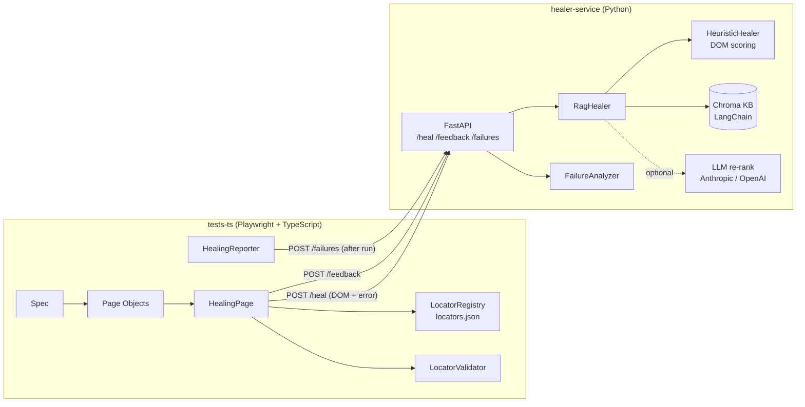

# Self-Healing Playwright Framework with a RAG Locator Healer

A UI test framework for [demo.opencart.com](https://demo.opencart.com/) built with **Playwright + TypeScript**. When a locator breaks, the framework sends the page DOM and error over a **REST API** to a **Python (FastAPI + LangChain + Chroma) RAG service**. The service proposes replacement locators, the framework **validates them in the live page**, retries the action, and reports the outcome back so the service learns.



## What is in the repo

| Folder | Purpose |
|---|---|
| `tests-ts/` | Playwright + TypeScript framework: `pages/`, `components/`, `fixtures/`, `healing/`, `api/`, `utils/`, `config/`, `locators/`, `types/`, `reporters/`, `tests/` (smoke, e2e, healing, integration), `test-data/` |
| `healer-service/` | Python service: `api/`, `core/`, `models/`, `services/`, `rag/`, `llm/`, `tests/` |
| `docs/LLD.md` | Low-level design, sequence diagram, contracts |
| `docker-compose.yml`, `.github/workflows/ci.yml` | Run the service in Docker; CI pipeline |

## Flows covered (OpenCart demo)

- **Smoke:** store front loads, top menu opens *Phones & PDAs*, search finds the iPhone.
- **Smartphone category** (`/en-gb/catalog/smartphone`): lists phones, adds *any* phone (the first listed) to the cart, adds a named phone, adds 2 units from the product page.
- **Cart:** shows the added phone, updates quantity, removes the item (empty cart message).
- **Guest checkout:** add any phone, cart, checkout, personal details, shipping address, shipping method, payment method, confirm order, "Your order has been placed!".
- **Self-healing:** the same flows with selected locators deliberately made stale; the framework must heal them and still finish the purchase.

## Quick start

**1. Healer service** (Python 3.11+)

```bash
cd healer-service
python -m venv .venv && source .venv/bin/activate      # Windows: .venv\Scripts\activate
pip install -r requirements-dev.txt
cp .env.example .env                                    # LLM_PROVIDER=none works with no API key
uvicorn app.main:app --port 8000
pytest                                                  # 30 tests
```

Or `docker compose up --build` from the repo root.

**2. Tests** (Node 20+)

```bash
cd tests-ts
npm install
npx playwright install chromium
cp .env.example .env

npm run test:smoke       # fast sanity check of the live site
npm run test:e2e         # smartphone, cart and checkout flows
npm run test:healing     # stale locators healed through the service (service must be running)
npm run test:offline     # same healing loop against a local mock page, no internet needed
npm run test:drift       # run all @e2e flows with stale locators injected
npm run report           # open the Playwright HTML report
```

After a run, open `tests-ts/reports/healing/healing-report.md` for healed locators and failure analysis.

### Optional: use an LLM

In `healer-service/.env` set `LLM_PROVIDER=anthropic` (or `openai`), add the API key, and `pip install -r requirements-llm.txt`. The LLM then re-ranks candidates using the DOM digest plus similar past repairs retrieved from the knowledge base. If the LLM is down or returns junk, the service silently falls back to heuristics + memory.

## How healing works

1. Page objects use locator **keys** (`checkout.firstName`), resolved by `LocatorRegistry` from `src/locators/locators.json`.
2. `HealingPage` tries the selector with a short timeout (`HEAL_ACTION_TIMEOUT_MS`, default 5 s).
3. If it fails *and the selector does not resolve to a single visible element*, it sends a privacy-scrubbed DOM snapshot and the error to `POST /heal`.
4. The service checks its **memory** (previous successful heals), scores visible interactive elements against the **intent tokens** of the broken selector, retrieves similar past cases from **Chroma**, and optionally lets an **LLM** re-rank.
5. The framework **validates** each candidate (exactly one visible element, right element type for the action), retries the action, and calls `POST /feedback`.
6. The heal is recorded and listed in the report. After the run, failed tests are posted to `POST /failures` for categorisation (locator drift, assertion, network, ...) and fix hints.

Design rules: only element *lookups* are healed, never assertions; low-confidence candidates (`MIN_CONFIDENCE`, default 0.6) are ignored; if the service is down the test fails normally; `MAX_HEALS` can fail a build that heals too much so healing never hides real breakage.

## What has been verified, and what has not

Verified while building (in a sandbox with no access to the public internet):

- Python service: **30 pytest tests pass** (heuristics, API, memory learning, LLM path with a fake provider, failure classification).
- TypeScript: `tsc --noEmit` is clean and Playwright discovers all 13 tests.
- Offline integration against a local OpenCart-style page with a real Chromium and the live service: **6 of 6 stale locators healed to the correct elements** (including a check that the neighbouring `address-2` field stayed empty), a repeated heal answered **from memory**, a page with no matching element **failed clearly instead of healing wrongly**, and the reporter posted a failed test to `/failures` and classified it.

**Not verified: the specs against the live demo.opencart.com.** The sandbox could not reach it. The real-site locators in `locators.json` follow OpenCart 4.x conventions, but the checkout markup in particular varies between OpenCart 4 minor versions, and the public demo is shared and resets. Expect to run `test:smoke` and `test:e2e` once and adjust a locator or two in `locators.json`. That is a one-file change and a fair demonstration of why the registry exists.

## Making it yours

- Run it and record your own numbers (heal success rate, false-heal rate, time per heal). Each heal currently costs about 5 s because the first attempt waits `HEAL_ACTION_TIMEOUT_MS`; lower it to speed up healing.
- Ideas to extend: a real embedding model, an LLM-written failure summary, a dashboard over `healing-report.json`, healing for Cypress/Selenium through the same API.
