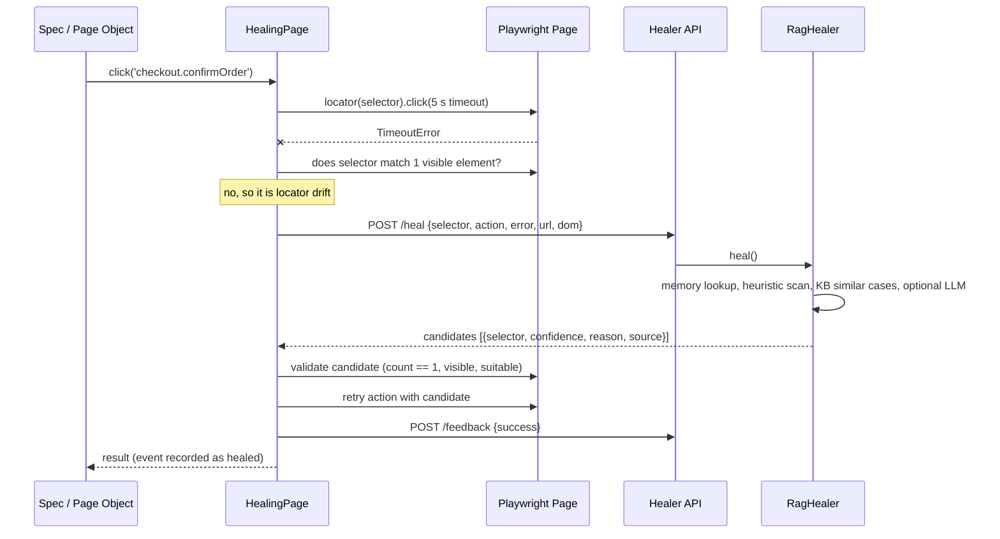

# Low-Level Design

## 1. Components

**tests-ts (Playwright + TypeScript)**

| Component | Responsibility |
|---|---|
| `LocatorRegistry` | Resolves locator keys to selectors (`locators.json`), interpolates `{params}`, applies drift simulation, keeps healed replacements (`reports/healing/healed-locators.json`) |
| `HealingPage` | Wraps `Page`. Runs actions by key, detects locator failures, calls the healer, validates, retries, records events |
| `LocatorValidator` | Accepts a candidate only if it resolves to exactly one visible element suitable for the action |
| `HealerClient` | REST client: timeout, one retry, circuit breaker (3 failures pause calls for 60 s), degrades to `null` |
| `captureDom` | Compact body snapshot; strips scripts/styles/svg/comments and values of sensitive inputs |
| Page objects / components | `BasePage`, `HomePage`, `SmartphonePage`, `ProductPage`, `CartPage`, `CheckoutPage`, `OrderSuccessPage`, `HeaderComponent`, `AlertComponent` |
| `HealingReporter` | Collects heal events and failures; after the run posts failures to `/failures`, writes `healing-report.{json,md}`, enforces `MAX_HEALS` |
| Fixtures | Wire registry + client + page objects into Playwright `test` |

**healer-service (Python)**

| Component | Responsibility |
|---|---|
| `api/` | `POST /heal`, `POST /feedback`, `POST /failures`, `GET /health`, `GET /stats` |
| `HeuristicHealer` | Extracts intent tokens from the broken selector; scores visible interactive elements; builds unique selectors (data-testid, id, name, aria-label, title, placeholder, text, classes, else positional `>> nth=i`) |
| `KnowledgeBase` | Chroma store via LangChain: past heals (with success flag) and failures |
| `RagHealer` | Memory lookup, heuristics, similar-case retrieval, optional LLM re-rank, dedupe |
| `FailureAnalyzer` | Rule-based classification plus similar past failures; optional LLM summary |
| `llm/` | `LLMProvider` interface with `none`, `anthropic`, `openai`; any problem degrades to `none` |
| `rag/embeddings` | Offline hashing embeddings by default, OpenAI optional |

## 2. Heal sequence

## 3. REST contracts

| Endpoint | Request | Response |
|---|---|---|
| `POST /heal` | test_name, action (`click\|fill\|select\|check\|wait`), failed_selector, error, page_url, dom | candidates[{selector, confidence, reason, source}], strategy, retrieved_cases |
| `POST /feedback` | failed_selector, healed_selector, success, page_url, test_name, reason | stored |
| `POST /failures` | test_name, file, status, error, duration_ms, retry, failed_selector | category, summary, suggested_fix, similar_cases, used_llm |
| `GET /health`, `GET /stats` | none | status/provider info, knowledge base counts |

Interactive docs are served by FastAPI at `/docs`.

## 4. Knowledge base records

- `kind=heal`: failed_selector, healed_selector, success, page_url, test_name. Only `success=true` records are used as exact-match memory.
- `kind=failure`: category, test_name, failed_selector, error signature.

Lookup order: exact metadata match (memory, confidence 0.95), then semantic top-k for the LLM prompt.

## 5. Scoring (heuristic healer)

Hint tokens come from the broken selector (attribute names and syntax removed, camelCase split, synonyms normalised, e.g. basket → cart). Each element's identity tokens (tag, id, name, title, placeholder, aria-label, text, formaction route, non-utility classes, plus joined adjacent words) are matched against the hints. Generic words (`btn`, `input`, `customer` ...) weigh 0.25, others 1.0. Elements that cannot perform the action (fill on a button) are excluded; hidden and disabled elements are skipped. Positional selectors lose 0.1 confidence.

## 6. Failure handling and safety

- Healer down or slow: test fails normally; circuit breaker avoids repeated waits.
- LLM down or malformed JSON: heuristics + memory only.
- Assertions are never healed; healed runs are flagged in the report; `MAX_HEALS` can gate CI.
- DOM snapshots strip scripts and values of text, e-mail, password, tel, search and number inputs before leaving the machine.

## 7. Known limits

- Hashing embeddings are lexical, not semantic; use `EMBEDDINGS_PROVIDER=openai` for semantic retrieval.
- Heuristics rely on meaningful attribute names; if a redesign removes all of them, only the LLM path can help, and positional selectors are less stable.
- `healed-locators.json` is a suggestion list: review it and update `locators.json`.
